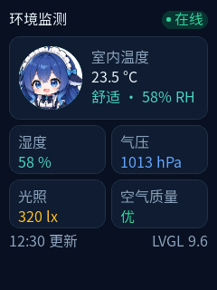

# lvglui — preview any ESP-IDF + LVGL project on the PC

[简体中文](README.md) | English

Current release candidate: `1.0.0-rc.1` (Windows).

`lvglui` compiles the project's own LVGL UI sources into a PC program: a PNG for headless
rendering, CI and models, and a window for live iteration.

It targets **existing ESP-IDF 6.x + LVGL 9.x projects**: the LVGL component, display driver
and touch BSP are already in place; `lvglui` only handles the UI layer — scaffolding, preview,
screenshots and the widget tree.

<p align="center">
  
</p>

<p align="center">A 240×320 LVGL page rendered on the PC by lvglui; the source is in
<a href="examples/demo-sensor/">examples/demo-sensor</a>.</p>

## Prerequisites

- Windows 10/11
- Node.js 22+
- Visual Studio 2022 (Desktop development with C++)
- ESP-IDF **6.x** (discovered from the project's own `build/project_description.json`,
  `.vscode/settings.json`, `lvglui.json` or `IDF_PATH` — the global environment is not trusted)
- A working LVGL **9.x** in the project, with display/touch already functional
- UI `.c` files include only LVGL and their own headers; **do not** include platform headers
  such as `driver/`, `esp_` or `freertos/`

## Quick start

```bash
# 1. Check project/LVGL/IDF/toolchain (before the UI exists this only warns and
#    prints the next step; it is not a failure)
node cli/lvglui.mjs doctor --project D:/my_project --width 240 --height 320

# 2. Inject the UI component into the existing project (adds files, changes none)
node cli/lvglui.mjs init --project D:/my_project --width 240 --height 320

# 3. (Optional) Add a page to a template project: generates .c/.h, appends the
#    registration entry and updates CMakeLists
node cli/lvglui.mjs new settings --project D:/my_project

# 4. Headless render -> .lvglui/out/shot.png + tree.json + meta.json
node cli/lvglui.mjs render --project D:/my_project

# 5. Live preview window (save the UI and it rebuilds in about a second)
node cli/lvglui.mjs preview --project D:/my_project
```

`init` will:

- create `components/app_ui/` (or the `uiDir` in `lvglui.json`) and a sibling `components/ui_port/`
- create `lvglui.json`
- print an integration snippet to stdout; paste it into `main` (usually replacing the existing
  `lv_screen_load(...)`)

If width/height can be inferred unambiguously from `sdkconfig`, `--width/--height` may be
omitted; otherwise the command fails instead of silently assuming 240×320.

## Layout

```
cli/                CLI entry + MCP stdio server
core/               project discovery, config, IDF/LVGL, build, render, diagnostics, DSH install
host/               PC shell: window, timing, PNG, UI tree, ABI
ui-template/        UI component template injected by init
examples/           copyable example UIs (demo-sensor etc.)
assets/             bundled fonts and third-party assets
dsh/                DeepSeek Harness bundle (skill + MCP client)
test/               node:test unit + integration tests
```

Artifacts are written only to `<project>/.lvglui/build/` and `<project>/.lvglui/out/`:

- `build/`: `lv_conf.h`, `lvglui.cmake`, `build.cmd`, `build.log`, `shot.exe`, `preview.exe`, `ui.dll`
- `out/`: `shot.png`, `tree.json`, `meta.json`

## lvglui.json

```json
{
  "schema": 1,
  "idfPath": "E:/esp/v6.1/esp-idf",
  "lvglDir": "managed_components/lvgl__lvgl",
  "uiDir": "components/app_ui",
  "entry": "ui_start",
  "display": { "width": 240, "height": 320, "colorDepth": 16 },
  "build": { "dir": ".lvglui/build" },
  "font": { "mode": "off" }
}
```

- `idfPath` / `lvglDir` / `uiDir` may be relative to the project root
- `entry` is the UI entry function, `ui_start` by default
- `colorDepth` currently accepts `16` only
- `font.mode` defaults to `off` (no Chinese font); `project` uses a generated subset; `cjk` is
  LVGL's built-in CJK subset (incomplete coverage, kept for old configs); `freetype` uses
  runtime FreeType (you provide the component and the filesystem)
- `font.dynamic` defaults to `labels` (only the characters used by UI strings); `common`
  generates the 3755 GB2312 level-1 common characters + UI strings + ASCII, suited to dynamic
  Chinese text; `freetype` renders at runtime through FreeType
- with `font.mode == "project"`, `font.file`/`font.size`/`font.name` are written by `font add`;
  with `font.mode == "freetype"`, it writes `font.file`/`font.size`/`font.fsPath`/`font.freetypeDir`;
  do not edit them by hand
- `build.dir` must stay inside the project; defaults to `.lvglui/build`

## UI contract

```c
/* ui.h */
lv_obj_t *ui_start(lv_obj_t *parent);
```

- `parent == NULL`: create and return the root screen
- `parent != NULL`: build the page inside the parent and return its root

Business data goes through `ui_port.h` only:

```c
/* components/ui_port/include/ui_port.h — implementation in ui_port_impl.c in the same component */
float ui_port_get_temperature(void);
float ui_port_get_humidity(void);
void  ui_port_set_relay(bool on);
```

- the UI layer only declares/calls `ui_port_*`; it never touches business state
- `components/ui_port/` is the business adapter: header and implementation live there, and
  `app_ui`'s `CMakeLists.txt` lists `REQUIRES ... ui_port`
- `ui_port_stub.c` inside `app_ui` provides stubs for the PC build; it is an empty TU in firmware
- a missing implementation fails at link time instead of compiling quietly

> **Do not put `ui_port_impl.c` under `main/`.** `libmain.a` comes before `libapp_ui.a` and is
> scanned only once: when `main` is scanned nothing references `ui_port_*` yet, so that object
> file is never pulled in and `app_ui` later fails with
> `undefined reference to 'ui_port_get_temperature'`. Put it in the separate `ui_port`
> component (which `app_ui` depends on) instead.

Name widgets with `lv_obj_set_name(obj, "val_temp")` (the preview `lv_conf.h` forces
`LV_USE_OBJ_NAME` on; enable it in firmware too). `render` then gives you `tree.json` along
with the PNG; `x`/`y` there are relative to the parent, `absX`/`absY` are screen-absolute.

**What an assistant may edit**: `ui_port.h` only gets additive declarations (no signature or
type changes), `ui_port_stub.c` only its `#ifdef LVGLUI_HOST` preview values, and
`ui_port_impl.c` is read-only. When a new getter is needed the assistant must report the exact
line the firmware still needs instead of writing business code; `doctor` checks declared versus
defined `ui_port_*` functions and warns that firmware will fail to link while an implementation
is missing.

## Multi-page UIs

By default only the screen returned by the entry `ui_start()` is rendered. To render page by
page, implement three more functions in the UI component (an optional contract with fixed
signatures; no shared header layout needed):

```c
/* ui_pages.h */
int         ui_page_count(void);
const char *ui_page_name(int index);              /* stable id, used as the file name */
lv_obj_t   *ui_page_show(int index, lv_obj_t *parent);
```

`ui_page_show(index, NULL)` creates and loads its own root screen; with a non-NULL `parent`
it only builds inside that object and must not call `lv_screen_load`.

```bash
lvglui render --all-pages          # shot-<name>.png + tree-<name>.json per page, plus a shot-sheet.png overview
lvglui render --page settings      # render only this page, still writing shot.png / tree.json
lvglui render --scroll 120         # scroll the content to 120px first, then capture the visible viewport
```

- the contact sheet follows the `pages` order in `meta.json`: two columns for ≤4 pages,
  four otherwise, 8px gaps, `#101820` background, no text labels
- `meta.json` lists `name/png/sha256/bytes/nodes` per page under `pages[]`, with `allPages: true`
- implementing none of the `_page_` functions keeps the previous behaviour; implementing only
  some of them reports "incomplete contract" immediately instead of failing at link time
- each page gets its own `shot.exe` process so the LVGL engine is never reused and cannot
  leave dangling pointers
- `lv_timer`/`lv_anim` objects created by a page are not destroyed with the screen object. If a
  page can be destroyed (on-device paging, any screen deletion), keep the handle and delete it
  in the page root's `LV_EVENT_DELETE`, or let the callback write data only and never touch
  page widgets directly. The preview window caches pages and never deletes old screens for
  exactly this reason

The template created by `init` ships with `ui_pages.c` (one page, `home`). Adding a page with
`new` generates `include/pages/<name>.h` and `src/pages/<name>.c`, appends the registration
entry to the page table and, when the component uses an explicit `SRCS` list, adds the new
`.c` to `CMakeLists.txt`. Files are backed up to `.lvglui/backup/` before touching them; an
unrecognised page table or `CMakeLists.txt` structure is an error, never a guess, and a failed
run rolls back. Only template projects created by `init` are supported (the page table must
use single-line `{ "name", ui_page_xxx_create },` entries).

## Chinese fonts

No Chinese font is enabled by default. When you need one:

```bash
# Fixed strings: only the characters that appear in the UI
lvglui font add --project D:/my_project --preset noto-sans-sc --size 16

# Dynamic Chinese: 3755 GB2312 level-1 common characters + UI strings + ASCII
lvglui font add --project D:/my_project --preset noto-sans-sc --dynamic common --size 16

lvglui font status --project D:/my_project
lvglui font off --project D:/my_project
```

The `labels` mode produces the smallest file and the sharpest glyphs; `common` covers everyday
Chinese text such as status strings, device names and user input that only exist at runtime.
A 16px 4bpp common font `.c` file is about 3 MB; the actual footprint depends on linker garbage
collection.

`labels` scans the C string literals under `uiDir` and generates a subset of exactly those
characters with the bundled Noto Sans SC; `common` additionally includes the GB2312 level-1
characters:

```text
components/app_ui/fonts/ui_font_noto_sc_16.c       # labels
components/app_ui/fonts/ui_font_noto_sc_16_common.c # common
components/app_ui/include/ui_font.h
```

The preview and the firmware compile the same `.c`. When the template project has
`src/ui_theme.c` the font is attached to the theme automatically; for projects without a theme
file, `src/ui_font_apply.c` is generated, applied automatically by the preview, and firmware
must call it once after `ui_start`:

```c
lvglui_apply_font(lv_screen_active());
```

Font sources and the OFL license live in `assets/fonts/`. `font status` reports missing glyphs;
`font add` lists the files it `created` / `updated` / `removed`, and the size is global: changing it
reflows every text that uses the font, so render again afterwards;
re-run `font add` after changing UI text.

### FreeType (optional advanced mode)

Use runtime FreeType when you need arbitrary Chinese text and do not want to regenerate the
subset after every text change. This is BYO: the tool only copies the TTF, generates config and
the apply code; it does not provide `esp_freetype`, partition tables or a SPIFFS image.

```bash
lvglui font add --project D:/my_project \
  --dynamic freetype \
  --font D:/fonts/NotoSansSC-Regular.ttf \
  --fs-path A:/fonts/NotoSansSC-Regular.ttf \
  --freetype-dir E:/freetype
```

- `--font`: TTF/OTF source file; copied into `components/app_ui/fonts/`
- `--fs-path`: runtime path in firmware (usually a SPIFFS/FATFS mount point), default
  `A:/fonts/<file name>`
- `--freetype-dir`: **preview-side** FreeType installation prefix (containing
  `include/freetype2` and `lib`); when omitted, CMake searches the system paths

On the firmware side you need `LV_USE_FREETYPE=1`, `esp_freetype` (or an equivalent
implementation), and the TTF flashed into the filesystem pointed to by `fs-path`. The preview
side needs host FreeType headers/libraries; on Windows also add the directory containing
`freetype.dll` to `PATH`, otherwise rendering fails to find the DLL.

The generated `src/ui_font_apply.c` creates the font under `LVGLUI_FONT_PATH`; the host build
overrides that macro with the absolute path of the in-project TTF, firmware uses `fs-path`.
Projects without `ui_theme.c` still have to call this once after `ui_start` in firmware:

```c
lvglui_apply_font(lv_screen_active());
```

FreeType generates no `.c` font data and keeps the project small, but costs RAM at runtime and
pays parsing cost on first render; the character set is unlimited. `font off` deletes the copied
TTF, the apply code and the config entries.

## Commands

| Command | Purpose |
| --- | --- |
| `render` | Compile + run 12 frames + write PNG/tree/meta (default command) |
| `build` | Compile the host renderer only |
| `watch` | Watch `.c/.h` under `uiDir`, re-render after a 300ms debounce |
| `serve` | HTTP + SSE preview (`127.0.0.1:8765`, auto-increments when taken) |
| `preview` | Open the live window; save → rebuild → swap `ui.dll`, keep the old frame on failure; the window can be dragged anywhere and remembers it; multi-page UIs switch with `PgUp`/`PgDn`, `←`/`→` or `1`–`9`; `--topmost` keeps it on top |
| `init` | Inject the UI component skeleton and `lvglui.json` |
| `new <name>` | Add a page to an `init` template: generate `.c/.h`, append to the page table, sync an explicit `SRCS` list; backs up first and refuses on a mismatch |
| `font add` | Generate a project font: labels subset by default, `--dynamic common` for the larger common-character set, `--dynamic freetype` for runtime FreeType |
| `font off` | Remove the project font, theme hook and CMake entries |
| `font status` | Show font mode, character counts and missing glyphs |
| `doctor` | Check project, IDF/LVGL versions, toolchain, display config and platform headers (may run before `init`: warns and suggests the next step when no UI exists yet) |
| `dsh install` | Generate `dsh/cordis.patch.yml` for the DSH bundle and print the install command |
| `help` | Help |

Common options:

- `--project <dir>`: project directory (defaults to `LVGLUI_PROJECT` or cwd)
- `--width/--height`: display size; required when the project does not configure it
- `--frames <n>`: number of rendered frames, 12 by default
- `--out <dir>`: output **directory** (not a PNG file path)
- `--no-build`: reuse an existing `shot.exe` (it is built automatically when missing)
- `--page <name|n>`: for `render`, render only that page; for `preview`, use it as the start page
  (page name, or a 1-based page number; requires the `ui_page_*` contract)
- `--scroll <spec>`: `render` scrolls before capturing and records the offset in `meta.json.scroll`;
- `--max-heap-pct <1-100>`: after `render`, check the LVGL heap percentage; above the limit sets
  `meta.budget.exceeded: true` (exit code stays 0, so the MCP client and skill can require
  optimisation before delivery); cannot be combined with `--all-pages`
  `120` scrolls the first vertically scrollable object on the current screen, `name=120` names the
  object, `name=bottom` / `name=top` jump to an end (the object needs `lv_obj_set_name`); cannot be
  combined with `--all-pages`
- `--all-pages`: render every page and an additional `shot-sheet.png` overview
- `--topmost`: keep the `preview` window on top (while it is open, `Ctrl+Alt+T` toggles this too)
- `--json`: `render/build/doctor/new` write JSON only to stdout, logs go to stderr
- `--no-render`: skip rendering a blank page after `init`
- `--dry-run`: `new` only reports which files would be created/modified, writes nothing
- `--preset noto-sans-sc`: use the bundled font in `font add`
- `--size 8..64`: font pixel size
- `--chars "保存"`: extra characters to include in the font (still merged with UI strings)
- `--dynamic labels|common|freetype`: `labels` takes UI characters only (default); `common`
  adds the 3755 GB2312 level-1 characters; `freetype` uses runtime FreeType
- `--font <ttf>`: source font file for `font add` (bundled Noto Sans SC by default)
- `--fs-path A:/fonts/x.ttf`: FreeType runtime path in firmware
- `--freetype-dir <prefix>`: preview-side FreeType installation prefix
- `--name ui_font_xxx`: generated font symbol name

Exit codes: `0` success, `1` build/render failure, `2` usage/config error, `3` runtime/IO error.

### Live preview details

- **Where you drop it is where it stays**: the whole canvas acts as the title bar (1.x has no
  clickable controls); the position is saved in `.lvglui/build/preview-window.txt` and restored
  the next time you run `preview`.
- **Keep it in sight**: `preview --topmost` keeps the window above everything else, so you do
  not have to switch windows while editing. `Ctrl+Alt+T` toggles it at any time and the title
  bar shows `[topmost]`; the toggle is remembered along with the position.
- **Wheel**: the mouse wheel scrolls the deepest scrollable container under the pointer
  (`Shift` scrolls horizontally) through LVGL's own `lv_obj_scroll_by` — this is not a simulation.
  A capture only ever contains the visible viewport, because LVGL draws only what is on screen;
  to capture a scrolled view, pin the offset with `render --scroll` and `meta.json` records the
  resolved object and offset.
- **Multi-page switching**: for projects implementing `ui_page_*`, the `preview` title shows
  `page 2/3 settings`; `PgUp`/`PgDn` or `←`/`→` cycle through pages, `1`–`9` jump straight to
  page N, and `preview --page settings` starts on a given page. Without `--page`, the template
  contract treats the entry screen as page 1 (`ui_start()` is `ui_page_show(0, parent)`), so the
  first `→` goes straight to page 2. Each page is built on first visit and its screen is then
  reused from cache; old pages are never destroyed — a page may update widgets from
  `lv_timer`/`lv_anim`, and deleting its screen would let those callbacks touch freed objects.
  The cache is bounded by the page count, so it does not grow with key presses. After a rebuild
  the window stays on the current page; if that page was removed it falls back to the entry
  screen. This is viewer navigation only, with no input injection.
- **Save to refresh is about one second**: the first start caches the `vcvars64.bat`
  environment as `.lvglui/build/build-fast.cmd`; every save then runs only
  `cmake --build --target ui`, skipping the 1.3s vcvars and 0.3s configure steps. Files are
  polled every 50ms with a 100ms debounce.
- On a failed build the window keeps the previous frame and the title becomes
  `reload failed (see build.log)`; it does not retry every 100ms and flood the log.
- To watch mouse/move events, set `LVGLUI_PREVIEW_DEBUG=1`; the log goes to
  `.lvglui/build/preview-debug.log`.

## Memory

`render` and `preview` report LVGL's own heap, which the firmware allocates from too
(`LV_MEM_SIZE` in the generated `lv_conf.h`, usually 64 KB):

```json
"memory": { "lvgl": { "total": 60912, "free": 42416, "maxUsed": 19200,
                      "usedCount": 266, "usedPct": 31, "fragPct": 1 } }
```

`lvglui render --max-heap-pct 70` adds
`"budget": { "heapPct": 70, "measured": true, "exceeded": false }`; when `usedPct` goes above the
budget, `exceeded` flips to `true` (the exit code stays 0 — the frame is still valid, but the MCP
client and the skill treat it as "optimise before delivery"). `render_ui` exposes the same numbers
as `memory` / `budget`, so an assistant can be held to a limit without guessing.

- `total` / `free` / `maxUsed` are bytes inside the LVGL pool; `usedCount` is the number of live
  allocations;
- with `allPages`, `memory.lvgl` is the worst page and `memory.perPage` lists each page, so a
  single heavy page can be optimised on its own;
- `maxUsed` is this process's high-water mark — compare it across page switches to spot growth;
- process RSS is not reported: it includes textures, fonts and unrelated allocations and would
  mislead;
- the preview prints the same line after attach and after each page switch, and appends it to
  `.lvglui/build/preview-mem.log` (the CLI ignores the window's stdio, so the file is the
  durable place to read it);
- with `LV_USE_STDLIB_MALLOC` set to clib or a custom allocator there is no monitor, so `memory`
  is omitted instead of faking numbers.

## Using it from DSH

```bash
node cli/lvglui.mjs dsh install
# the output gives you:
# plugin_manager install_bundle target="file:D:/LVGL_preview/dsh"
```

Then restart DSH. After the restart:

- `lvglui` appears in the skill list
- `mcp__lvglui__*` tools appear (`detect_project`, `init_ui`, `render_ui`, `build_ui`, `doctor`,
  `font`,
  `preview_ui`)

Just ask:

> Turn the home page in D:/my_project into three sensor cards, get the data through ui_port,
> and show me a screenshot when you are done.

The skill's constraints are prose agreements: only touch `uiDir` (including the sibling
`ui_port` component), never `main`/BSP/`sdkconfig`/project CMakeLists, never include platform
headers, and route business data only through `ui_port`. There is no enforced write fence and
no automatic audit.

> Moving the tool directory requires re-running `dsh install` and reinstalling the bundle;
> `dsh/cordis.patch.yml` is generated and git-ignored.

## Limitations

- **Static** rendering + widget tree only; click/swipe/animation simulation is out of scope for
  1.x and is planned for 2.0
- **16-bit** color depth only
- Windows + ESP-IDF 6.x + LVGL 9.x
- does not pull LVGL components, configure the component manager or build a display/touch BSP
- no write audit; the UI-layer boundary is enforced by the skill's prose rules only
- **no flashing, no serial ports**: the tool has no `flash` command and the MCP server exposes
  no serial/flash capability. It only builds a host preview artifact; writing firmware to the
  board is always a manual step (`idf.py flash`). Likewise, the tool never touches eFuse,
  bootloader or partition tables — those are the truly irreversible operations

### Pixel parity prerequisites

`render` reuses the project's real UI sources, the same LVGL version and the same `lv_conf.h`,
so static frames can match the firmware. Byte-for-byte parity requires all of the following:

- **Theme**: the host does not hard-code a theme; `lv_display_create()` picks it from
  `LV_USE_THEME_DEFAULT / SIMPLE / MONO`, just like firmware. If the project calls
  `lv_display_set_theme()` in its UI entry, it applies on both sides. If firmware only changes
  the theme during BSP init and the host cannot see that code, move it into `ui_start()` /
  `ui_theme_init()`; otherwise themed buttons, sliders, switches and so on will differ from the
  device
- **Fonts**: with the `font` feature enabled the host applies the generated font automatically;
  firmware must call the same `lvglui_apply_font()` (the template's `ui_theme.c` already hooks it)
- **Static instant**: the default 12 frames × 33ms sample the "stable frame after startup".
  Intermediate states after animations or timer callbacks depend on real firmware milliseconds
  and are outside the pixel-parity guarantee
- **Display parameters**: the host fixes RGB565 and renders at the `--width/--height` or
  sdkconfig resolution; rotation, byte swapping, panel gamma and backlight are hardware
  behaviour and outside the rendering guarantee

On the same machine and toolchain, the SHA-256 baseline is reproducible; a different MSVC
version or a different machine can change floating-point and rendering details, so leave
tolerance when comparing across machines.

## Troubleshooting

| Symptom | Fix |
| --- | --- |
| `需要 ESP-IDF 6.x，发现 5.3` (needs ESP-IDF 6.x, found 5.3) | Set `idfPath` in `lvglui.json`, or fix `idf.currentSetup` in `.vscode/settings.json` |
| `需要 LVGL 9.x` (needs LVGL 9.x) | Check `managed_components/lvgl__lvgl` or `lvglDir` |
| vcvars/cmake/ninja not found | Install VS2022 C++ tools, or write explicit paths in `lvglui.json.build` |
| `cannot determine display resolution` | Pass `--width/--height`, set `lvglui.json.display`, or give `sdkconfig` a single unambiguous width/height pair |
| Compilation fails | Read `<project>/.lvglui/build/build.log` and the `diagnostics` from `render --json`; link errors (`LNK2019`/`LNK1120`, `undefined reference`) are parsed too |
| Chinese text shows boxes | Run `lvglui font status` first; then `font add --preset noto-sans-sc` if needed, and regenerate after text changes |
| `--no-build` still builds | Expected when `shot.exe` does not exist; run a full `render` first |

## Contributors

- Shinku_721 — project owner, requirements and acceptance
- **DeepSeek** — AI programming collaboration: architecture, implementation, tests, docs and
  release engineering

  

See [`CONTRIBUTORS.md`](CONTRIBUTORS.md) for the full list.

## License

- `lvglui` itself: **AGPL-3.0-or-later**, full text in [`LICENSE`](LICENSE).
- `ui-template/` and files generated by `lvglui init` / `font add`: covered by the additional
  exception in [`LICENSE-EXCEPTION`](LICENSE-EXCEPTION); they may be placed in projects under
  any license, and AGPL does not extend to your project.
- Noto Sans SC: SIL OFL 1.1, see [`assets/fonts/OFL.txt`](assets/fonts/OFL.txt).
- Third-party dependencies and notices: see [`NOTICE`](NOTICE).

If you modify and distribute `lvglui` itself, the AGPL source-offer obligation applies; UIs and
configs generated with `lvglui` are unaffected.

## Development

```bash
npm test                 # unit tests
npm run test:integration # integration (skipped when my_lcd is absent)
node cli/lvglui.mjs doctor --project D:/esps3_test/my_lcd
```

Regression baseline: `D:/esps3_test/my_lcd`, 240×320, `sensor_ui_create`, 12 frames, PNG
sha256 `8f3a7ad7e177e94953547ae30e47149d5139de638d87a56449a2f9ea03ddd287`.