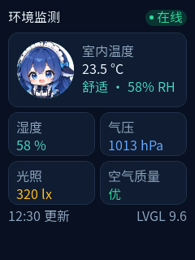

# lvglui — 在 PC 上预览任意 ESP-IDF + LVGL 工程

当前发布候选：`1.0.0-rc.1`（Windows）。

`lvglui` 把工程里同一份 LVGL 界面源码编成 PC 程序：一张 PNG 给无头渲染/CI/模型看，一个窗口给你实时改。

它面向**已有的 ESP-IDF 6.x + LVGL 9.x 工程**：LVGL 组件、显示驱动、触摸 BSP 都由工程自己准备好；`lvglui` 只负责 UI 层的搭建、预览、截图和控件树。

<p align="center">
  
</p>

<p align="center">一个 240×320 的 LVGL 页面，由 lvglui 在 PC 上渲染；源码见 <a href="examples/demo-sensor/">examples/demo-sensor</a>。</p>

## 前置条件

- Windows 10/11
- Node.js 22+
- Visual Studio 2022（C++ 桌面开发）
- ESP-IDF **6.x**（工具会从工程自己的 `build/project_description.json`、`.vscode/settings.json`、`lvglui.json` 或 `IDF_PATH` 发现它，不信任全局环境）
- 工程里已有可用的 LVGL **9.x**，并且显示/触摸已经能工作
- 界面 `.c` 只 include LVGL 和 UI 自己的头；**不要** include `driver/`、`esp_`、`freertos/` 等平台头

## 快速开始

```bash
# 1. 检查工程/LVGL/IDF/工具链（还没注入 UI 时只给 warn 和下一步提示，不算失败）
node cli/lvglui.mjs doctor --project D:/my_project --width 240 --height 320

# 2. 在现有工程里注入 UI 组件（只新增文件，不改现有文件）
node cli/lvglui.mjs init --project D:/my_project --width 240 --height 320

# 3. 无头渲染 → .lvglui/out/shot.png + tree.json + meta.json
node cli/lvglui.mjs render --project D:/my_project

# 4. 实时预览窗口（改 UI 保存即重编，约 1 秒）
node cli/lvglui.mjs preview --project D:/my_project
```

`init` 会：

- 创建 `components/app_ui/`（或 `lvglui.json` 指定的 `uiDir`）和旁边的 `components/ui_port/`
- 创建 `lvglui.json`
- 在 stdout 打印一段接入代码；需要你把它粘到 `main` 里（通常替换原来的 `lv_screen_load(...)`）

如果 `sdkconfig` 里能唯一推断出宽高，可以省略 `--width/--height`；推断不出时命令会失败，不会偷偷用 240×320。

## 目录

```
cli/                 CLI 入口 + MCP stdio server
core/                工程发现、配置、IDF/LVGL、构建、渲染、诊断、DSH 安装
host/                PC 壳：窗口、计时、PNG、UI 树、ABI
ui-template/         init 注入的 UI 组件模板
examples/            可复制的示例 UI（demo-sensor 等）
assets/              内置字体与第三方素材
dsh/                 DeepSeek Harness bundle（skill + MCP client）
test/                node:test 单测 + 集成测试
```

产物只写 `<project>/.lvglui/build/` 和 `<project>/.lvglui/out/`：

- `build/`：`lv_conf.h`、`lvglui.cmake`、`build.cmd`、`build.log`、`shot.exe`、`preview.exe`、`ui.dll`
- `out/`：`shot.png`、`tree.json`、`meta.json`

## lvglui.json

```json
{
  "schema": 1,
  "idfPath": "E:/esp/v6.1/esp-idf",
  "lvglDir": "managed_components/lvgl__lvgl",
  "uiDir": "components/app_ui",
  "entry": "ui_start",
  "display": { "width": 240, "height": 320, "colorDepth": 16 },
  "build": { "dir": ".lvglui/build" },
  "font": { "mode": "off" }
}
```

- `idfPath` / `lvglDir` / `uiDir` 可相对工程根
- `entry` 是 UI 入口函数，默认 `ui_start`
- `colorDepth` 目前只接受 `16`
- `font.mode` 默认 `off`：不启用中文字体；`project` 用工程生成的子集；`cjk` 是 LVGL 自带 CJK 子集（覆盖不全，仅兼容旧配置）；`freetype` 用运行时 FreeType（用户自带组件与文件系统）
- `font.dynamic` 默认 `labels`：只生成 UI 字符串用到的字符；`common` 生成 GB2312 一级 3755 常用字 + UI 字符 + ASCII，适合动态中文；`freetype` 由运行时 FreeType 渲染
- `font.mode == "project"` 时，`font.file`/`font.size`/`font.name` 由 `font add` 写入；`font.mode == "freetype"` 时写 `font.file`/`font.size`/`font.fsPath`/`font.freetypeDir`；不要手改
- `build.dir` 只能指向工程内；默认 `.lvglui/build`

## UI 契约

```c
/* ui.h */
lv_obj_t *ui_start(lv_obj_t *parent);
```

- `parent == NULL`：创建并返回根 screen
- `parent != NULL`：在父对象里建页面，返回页面根

业务数据只通过 `ui_port.h`：

```c
/* components/ui_port/include/ui_port.h —— 业务实现在同组件的 ui_port_impl.c */
float ui_port_get_temperature(void);
float ui_port_get_humidity(void);
void  ui_port_set_relay(bool on);
```

- UI 层只声明/调用 `ui_port_*`，不碰业务状态
- `components/ui_port/` 是业务适配层：头文件 + 实现都在这里，`app_ui` 的 `CMakeLists.txt` 写 `REQUIRES ... ui_port`
- `app_ui` 里的 `ui_port_stub.c` 在 PC 构建时提供桩；固件构建时是空 TU
- 缺实现会在链接期报错，不会悄悄编过

> **不要把 `ui_port_impl.c` 放进 `main/`。** `libmain.a` 排在 `libapp_ui.a` 之前且只被扫描一次，
> 扫 main 时还没有人引用 `ui_port_*`，那个 .obj 不会被拉进来，后面 app_ui 需要时就报
> `undefined reference to 'ui_port_get_temperature'`。放进独立组件 `ui_port`（app_ui 依赖它）才对。

控件命名用 `lv_obj_set_name(obj, "val_temp")`（预览 `lv_conf.h` 强制开启 `LV_USE_OBJ_NAME`；固件侧也要开），渲染时 `tree.json` 和 PNG 一起给你。

## 多页界面

默认只渲染入口 `ui_start()` 返回的那一屏。要让工具按页渲染，UI 组件里再实现三个函数（可选契约，签名固定，不需要共享头文件结构）：

```c
/* ui_pages.h */
int         ui_page_count(void);
const char *ui_page_name(int index);              /* 稳定 id，用作文件名 */
lv_obj_t   *ui_page_show(int index, lv_obj_t *parent);
```

`ui_page_show(index, NULL)` 自己创建根 screen 并加载它；`parent` 非 NULL 时只在该对象里建页，不要 `lv_screen_load`。

```bash
lvglui render --all-pages          # 每页 shot-<name>.png + tree-<name>.json，另出 shot-sheet.png 总览
lvglui render --page settings      # 只渲染这一页，仍写 shot.png / tree.json
```

- 总览图按 `meta.json` 的 `pages` 顺序排：≤4 页两列，否则四列，格间距 8px，底色 `#101820`，不放文字标签
- `meta.json` 里 `pages[]` 有每页的 `name/png/sha256/bytes/nodes`，`allPages: true`
- 一个 `_page_` 函数都不实现时，行为与今天完全一致；只实现一部分会直接报“契约不完整”，不会拖到链接期
- 每页单独起一个 `shot.exe` 进程，避免复用 LVGL 引擎产生悬空指针

`init` 生成的模板自带 `ui_pages.c`（默认一页 `home`），新增页面只需往页面表里加一行。

## 中文字体

默认不启用中文字体。需要时运行：

```bash
# 固定文案：只生成 UI 里出现的字符
lvglui font add --project D:/my_project --preset noto-sans-sc --size 16

# 动态中文：生成 3755 个 GB2312 一级常用字 + UI 字符 + ASCII
lvglui font add --project D:/my_project --preset noto-sans-sc --dynamic common --size 16

lvglui font status --project D:/my_project
lvglui font off --project D:/my_project
```

`labels` 模式生成的文件最小、字形最好；`common` 模式覆盖常用中文，适合状态文字、设备名、用户输入等运行时才确定的文本。16px 4bpp 的 common 字体 C 文件约 3 MB，实际占用取决于链接器裁剪。

`labels` 模式会扫描 `uiDir` 里的 C 字符串字面量，用工具自带的 Noto Sans SC 只生成这些字符的子集；`common` 模式会额外加入 GB2312 一级常用字：

```text
components/app_ui/fonts/ui_font_noto_sc_16.c       # labels
components/app_ui/fonts/ui_font_noto_sc_16_common.c # common
components/app_ui/include/ui_font.h
```

预览和固件编译同一个 `.c`。模板工程有 `src/ui_theme.c` 时自动挂到主题；已有工程没有主题文件时，会生成 `src/ui_font_apply.c`，预览自动应用，固件需在 `ui_start` 之后调用一次：

```c
lvglui_apply_font(lv_screen_active());
```

字体原件和 OFL 许可证在 `assets/fonts/`。`font status` 会报告缺字；改完 UI 文案后重新跑一次 `font add`。

### FreeType（可选高级模式）

需要任意中文、不想每次改文案都重新生成子集时，用 FreeType 运行时渲染。这是 BYO 模式：工具只复制 TTF、生成配置和 apply 代码，不提供 `esp_freetype`、分区表或 SPIFFS 镜像。

```bash
lvglui font add --project D:/my_project \
  --dynamic freetype \
  --font D:/fonts/NotoSansSC-Regular.ttf \
  --fs-path A:/fonts/NotoSansSC-Regular.ttf \
  --freetype-dir E:/freetype
```

- `--font`：TTF/OTF 源文件；会复制到 `components/app_ui/fonts/`。
- `--fs-path`：固件运行时路径（通常是 SPIFFS/FATFS 挂载点），默认 `A:/fonts/<文件名>`。
- `--freetype-dir`：**预览端** FreeType 安装前缀（含 `include/freetype2` 与 `lib`）；不传则让 CMake 在系统路径里找。

固件侧需要：`LV_USE_FREETYPE=1`、`esp_freetype`（或等价实现）、TTF 已烧进 `fs-path` 指向的文件系统。预览侧需要主机 FreeType 头/库；Windows 上还要把 `freetype.dll` 所在目录加入 `PATH`，否则渲染会报找不到 DLL。

生成的 `src/ui_font_apply.c` 在 `LVGLUI_FONT_PATH` 下创建字体；主机构建会用工程内 TTF 绝对路径覆盖该宏，固件用 `fs-path`。没有 `ui_theme.c` 的工程，固件仍需在 `ui_start` 后调用：

```c
lvglui_apply_font(lv_screen_active());
```

FreeType 不生成 `.c` 字库，工程体积小，但运行时占 RAM、首次渲染有解析成本；字符集不受限。`font off` 会删除复制的 TTF、apply 代码和配置项。

## 命令

| 命令 | 作用 |
| --- | --- |
| `render` | 编译 + 跑 12 帧 + 输出 PNG/tree/meta（默认命令） |
| `build` | 只编译 host 渲染器 |
| `watch` | 监听 `uiDir` 的 `.c/.h`，防抖 300ms 后重渲 |
| `serve` | HTTP + SSE 预览（`127.0.0.1:8765`，占用自动 +1） |
| `preview` | 打开实时窗口；保存→重编→换 `ui.dll`，失败保留旧画面；窗口可拖到任意位置并记住；`--topmost` 置顶 |
| `init` | 注入 UI 组件骨架和 `lvglui.json` |
| `font add` | 生成工程字体：默认 labels 子集，`--dynamic common` 常用字大子集，`--dynamic freetype` 运行时 FreeType |
| `font off` | 移除工程字体、主题挂载和 CMake 条目 |
| `font status` | 查看字体模式、字符数和缺字 |
| `doctor` | 检查工程、IDF/LVGL 版本、工具链、显示配置、平台头（可以在 `init` 之前跑：UI 还没注入时给 warn 和下一步提示） |
| `dsh install` | 生成 DSH bundle 用的 `dsh/cordis.patch.yml` 并打印安装命令 |
| `help` | 帮助 |

常用选项：

- `--project <dir>`：工程目录（默认 `LVGLUI_PROJECT` 或 cwd）
- `--width/--height`：显示尺寸；工程没配置时必填
- `--frames <n>`：渲染帧数，默认 12
- `--out <dir>`：输出**目录**（不是 PNG 文件路径）
- `--no-build`：复用已有 `shot.exe`（shot 缺失时会自动构建）
- `--page <name>`：只渲染某一页（需要 `ui_page_*` 契约）
- `--all-pages`：渲染所有页，另出 `shot-sheet.png` 总览
- `--topmost`：`preview` 窗口置顶（开着窗口时也可随时按 `Ctrl+Alt+T` 切换）
- `--json`：`render/build/doctor` 只向 stdout 输出 JSON，日志走 stderr
- `--no-render`：`init` 后不做空白页渲染
- `--preset noto-sans-sc`：`font add` 使用工具自带字体
- `--size 8..64`：字体像素大小
- `--chars "保存"`：额外加入字体的字符（仍会合并 UI 字符串）
- `--dynamic labels|common|freetype`：`labels` 只收 UI 字符（默认）；`common` 加 GB2312 一级 3755 常用字；`freetype` 用运行时 FreeType
- `--font <ttf>`：`font add` 的源字体文件（默认工具自带 Noto Sans SC）
- `--fs-path A:/fonts/x.ttf`：FreeType 固件运行时路径
- `--freetype-dir <prefix>`：预览端 FreeType 安装前缀
- `--name ui_font_xxx`：生成字体符号名

退出码：`0` 成功，`1` 构建/渲染失败，`2` 用法/配置错误，`3` 运行时/IO 错误。

### 实时预览的细节

- **窗口拖到哪就是哪**：整块画面都能当标题栏拖（1.x 没有可点的控件），松手后位置记在 `.lvglui/build/preview-window.txt`，下次 `preview` 原位打开。
- **想一直看着画面**：`preview --topmost` 让窗口始终在其它窗口之上，写代码时不用来回切。开着窗口也能用 `Ctrl+Alt+T` 随时置顶/取消，标题栏会显示 `[topmost]`；这个开关也会和位置一起记住。
- **保存到刷新约 1 秒**：第一次启动会把 `vcvars64.bat` 的环境缓存成 `.lvglui/build/build-fast.cmd`，之后每次保存只跑 `cmake --build --target ui`，省掉 1.3 秒的 vcvars 和 0.3 秒的 configure。文件轮询 50ms、防抖 100ms。
- 构建失败时窗口保留旧画面，标题变成 `reload failed (see build.log)`，不会每 100ms 重试刷屏。
- 想看鼠标/移动事件，设 `LVGLUI_PREVIEW_DEBUG=1`，日志写到 `.lvglui/build/preview-debug.log`。

## 在 DSH 里用

```bash
node cli/lvglui.mjs dsh install
# 输出里会给你：
# plugin_manager install_bundle target="file:D:/LVGL_preview/dsh"
```

然后重启 DSH。重启后：

- 技能列表里出现 `lvglui`
- 工具里出现 `mcp__lvglui__*`（`detect_project`、`init_ui`、`render_ui`、`build_ui`、`doctor`、`preview_ui`）

直接说：

> 在 D:/my_project 里把 home 页改成三个传感器卡片，数据走 ui_port，改完截图给我看。

skill 的约束是文字约定：只改 `uiDir`（含同级的 `ui_port` 组件）、不改 `main`/BSP/`sdkconfig`/工程 CMakeLists、不 include 平台头、业务只走 `ui_port`。没有强制写入围栏，也没有自动审计。

> 移动工具目录后必须重新跑 `dsh install`，再重新安装 bundle；`dsh/cordis.patch.yml` 是生成文件，已被 `.gitignore` 忽略。

## 限制

- 只做**静态**渲染 + 控件树；点击/滑动/动画模拟不在 1.x 范围内，留到 2.0
- 只支持 **16bit** 色深
- Windows + ESP-IDF 6.x + LVGL 9.x
- 不拉 LVGL 组件、不配 component manager、不搭显示/触摸 BSP
- 不做写入审计；UI 层边界靠 skill 约定
- **不烧录、不接触串口**：工具没有 `flash` 命令，MCP 也不暴露任何串口/烧录能力。它只编译出一份 host 预览产物；把固件写进板子始终是人工步骤（`idf.py flash`）。同理，工具从不操作 eFuse、bootloader、分区表——这些才是真正不可逆的操作

### 像素一致的前提

`render` 复用的是工程真实的 UI 源码、同一版 LVGL 和同一份 `lv_conf.h`，所以静态画面可以做到和固件一致；但要逐像素一致，下面几件事必须同时成立：

- **主题**：host 不硬编码主题，`lv_display_create()` 会按 `LV_USE_THEME_DEFAULT / SIMPLE / MONO` 自己选，和固件一致。工程如果在 UI 入口里调用 `lv_display_set_theme()`，两边同样生效；如果固件是在 BSP 初始化时才换主题、而 host 看不到那段代码，请把它挪进 `ui_start()` / `ui_theme_init()`，否则默认样式的按钮、滑杆、开关等会和固件不同
- **字体**：开了 `font` 特性后 host 会自动应用生成的字体；固件必须也调用同一处 `lvglui_apply_font()`（模板的 `ui_theme.c` 已自动挂钩）
- **静态时刻**：默认的 12 帧 × 33ms 采样的是"启动后稳定画面"。动画、定时器触发后的中间状态，取决于固件真实毫秒，不在逐像素保证范围内
- **显示参数**：host 固定 RGB565、按 `--width/--height` 或 sdkconfig 的分辨率渲染；旋转、字节序交换、面板 gamma/背光属于硬件行为，不在渲染保证范围内

同一台机器、同一套工具链下，SHA-256 基线保证可重复；换 MSVC 版本或换机器时，浮点/渲染细节可能变化，跨机器对比请留容差。

## 故障排查

| 现象 | 处理 |
| --- | --- |
| `需要 ESP-IDF 6.x，发现 5.3` | 在 `lvglui.json` 写 `idfPath`，或修 `.vscode/settings.json` 的 `idf.currentSetup` |
| `需要 LVGL 9.x` | 检查 `managed_components/lvgl__lvgl` 或 `lvglDir` |
| 找不到 vcvars/cmake/ninja | 装 VS2022 C++ 工具；或在 `lvglui.json.build` 写显式路径 |
| `cannot determine display resolution` | 传 `--width/--height`，或写 `lvglui.json.display`，或让 `sdkconfig` 有唯一的一对宽高 |
| 编译失败 | 看 `<project>/.lvglui/build/build.log` 和 `render --json` 的 `diagnostics`；链接错误（`LNK2019`/`LNK1120`、`undefined reference`）同样会被解析出来 |
| 中文显示方块 | 先 `lvglui font status`；需要时 `font add --preset noto-sans-sc`，改文案后重新生成 |
| `--no-build` 仍构建 | `shot.exe` 不存在时这是预期行为；先跑一次完整 `render` |

## 贡献者

- Shinku_721 — 项目所有者、需求与验收
- **DeepSeek** — AI 编程协作：架构、实现、测试、文档与发布工程

  

完整名单见 [`CONTRIBUTORS.md`](CONTRIBUTORS.md)。

## 许可证

- `lvglui` 本体：**AGPL-3.0-or-later**，全文见 [`LICENSE`](LICENSE)。
- `ui-template/` 以及 `lvglui init` / `font add` 生成的文件：适用 [`LICENSE-EXCEPTION`](LICENSE-EXCEPTION) 的附加例外，可放入任意许可证的工程，AGPL 不延伸到你的工程。
- Noto Sans SC：SIL OFL 1.1，见 [`assets/fonts/OFL.txt`](assets/fonts/OFL.txt)。
- 第三方依赖与声明见 [`NOTICE`](NOTICE)。

如果你修改并分发 `lvglui` 本体，AGPL 的源码提供义务适用；用 `lvglui` 生成的 UI/配置不受影响。

## 开发

```bash
npm test                 # 单测
npm run test:integration # 集成（my_lcd 不存在时跳过）
node cli/lvglui.mjs doctor --project D:/esps3_test/my_lcd
```

回归基线：`D:/esps3_test/my_lcd`、240×320、`sensor_ui_create`、12 帧、PNG sha256 `8f3a7ad7e177e94953547ae30e47149d5139de638d87a56449a2f9ea03ddd287`。