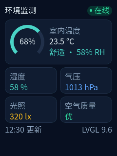

# Demo: ESP32-S3 sensor dashboard

A 240×320 LVGL 9.6 page used for the README screenshot.



## What it shows

- dark card layout on a 240×320 screen
- `lv_arc` gauge, two-column metric cards, status badge
- Chinese labels rendered from a project font subset
- entry point `ui_start(parent)` that fits both the previewer and firmware

## Use it in a project

Copy `components/app_ui` into your project, then copy `lvglui.example.json` to the
project root as `lvglui.json`:

```bash
cp -r examples/demo-sensor/components/app_ui ./components/app_ui
cp examples/demo-sensor/lvglui.example.json ./lvglui.json
```

If your LVGL component is managed as `lvgl__lvgl`, change the `REQUIRES` line in
`components/app_ui/CMakeLists.txt` accordingly, or let `lvglui init` generate the
component first and copy the two source files into it.

Generate the Chinese font subset:

```bash
lvglui font add --preset noto-sans-sc --size 16
lvglui render
```

The preview uses the same subset as the firmware. Without `font add`, English and
digits still render; Chinese labels fall back to the project's LVGL fonts.

## Files

- `include/ui.h` — `ui_start(lv_obj_t *parent)`
- `include/demo_page.h` — demo page constructor
- `src/ui.c` — entry point, returns the root object
- `src/demo_page.c` — the page layout and styles